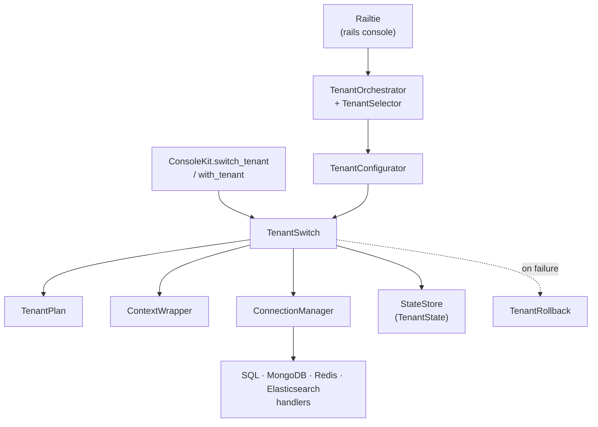
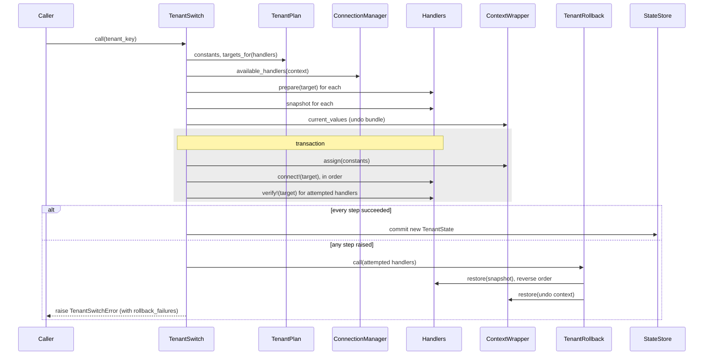

# Architecture Overview

How ConsoleKit is put together: which file owns what, and what happens during a tenant switch.
For configuration and day-to-day usage, see [Usage](../usage.md). Related:
[Backends](../guides/backends.md), [Writing a backend handler](../guides/custom-backend-handler.md),
[Configuration](../guides/configuration.md), [Public API](../api/public-api.md).

??? abstract "Relevant source files"

    - [`lib/console_kit/tenant_switch.rb`](https://github.com/Soumyadeep-ai/console_kit/blob/master/lib/console_kit/tenant_switch.rb)
    - [`lib/console_kit/tenant_plan.rb`](https://github.com/Soumyadeep-ai/console_kit/blob/master/lib/console_kit/tenant_plan.rb)
    - [`lib/console_kit/tenant_rollback.rb`](https://github.com/Soumyadeep-ai/console_kit/blob/master/lib/console_kit/tenant_rollback.rb)
    - [`lib/console_kit/tenant_state.rb`](https://github.com/Soumyadeep-ai/console_kit/blob/master/lib/console_kit/tenant_state.rb)
    - [`lib/console_kit/tenant_orchestrator.rb`](https://github.com/Soumyadeep-ai/console_kit/blob/master/lib/console_kit/tenant_orchestrator.rb)
    - [`lib/console_kit/tenant_configurator.rb`](https://github.com/Soumyadeep-ai/console_kit/blob/master/lib/console_kit/tenant_configurator.rb)
    - [`lib/console_kit/railtie.rb`](https://github.com/Soumyadeep-ai/console_kit/blob/master/lib/console_kit/railtie.rb)
    - [`lib/console_kit/connections/connection_manager.rb`](https://github.com/Soumyadeep-ai/console_kit/blob/master/lib/console_kit/connections/connection_manager.rb)
    - [`lib/console_kit/connections/base_connection_handler.rb`](https://github.com/Soumyadeep-ai/console_kit/blob/master/lib/console_kit/connections/base_connection_handler.rb)
    - [`lib/console_kit.rb`](https://github.com/Soumyadeep-ai/console_kit/blob/master/lib/console_kit.rb)

## Components

| Layer | Responsibility |
|---|---|
| `Railtie` | In `rails console`: runs `TenantOrchestrator.run`, labels the prompt, mixes in `ConsoleHelpers`. On code reload (`to_prepare`) it calls `TenantOrchestrator.reapply`. |
| `TenantOrchestrator` | Interactive flow: validate config, pick a tenant (auto-select when there is one tenant or stdin is not a TTY), configure, print banner. Handles `:exit`, `:abort`, `:none`. |
| `ConsoleKit` facade | Programmatic API: `switch_tenant`, `with_tenant`, `verify_tenant!`, `current_tenant`. |
| `TenantConfigurator` | Console-friendly wrapper around `TenantSwitch`: skips no-op switches and prints errors instead of raising. |
| `TenantSwitch` | The transaction. One instance per switch. |
| `TenantPlan` | Resolves a tenant key to its `:constants` hash, requires `:shard` and `:partner_code`, maps each handler to its target via `constants_key`. |
| `ContextWrapper` | Reads and writes tenant attributes on `context_class`. Only touches attributes that have a setter and whose handler is available. |
| `TenantRollback` | Restores backend snapshots in reverse order, then the context. Collects every failure, never stops at the first. |
| `TenantState` / `StateStore` | Frozen state value (tenant key, constants, undo bundle) stored in a thread variable. |

## Backend handlers

Each handler subclasses `BaseConnectionHandler` and registers itself with `backend`:

| Key | Display | Context attribute | Constants key |
|---|---|---|---|
| `:sql` | SQL | `tenant_shard` | `:shard` |
| `:mongo` | MongoDB | `tenant_mongo_db` | `:mongo_db` |
| `:redis` | Redis | `tenant_redis_db` | `:redis_db` |
| `:elasticsearch` | Elasticsearch | `tenant_elasticsearch_prefix` | `:elasticsearch_prefix` |

The handler contract:

| Method | Required | Purpose |
|---|---|---|
| `available?` | yes | Is this backend present in the app (gem loaded, base class resolvable)? |
| `snapshot` | yes | Capture current state for rollback. |
| `connect!(target)` | yes | Point the backend at the tenant target. |
| `restore(snapshot)` | yes | Undo `connect!`. |
| `prepare(target)` | no | Validate the target before anything changes. |
| `verify!(target)` | no | Confirm the backend really points at the target; raise `ConnectionVerificationError` if not. |
| `unavailable_reason` | no | When set, an unavailable handler is reported as *dropped* rather than silently skipped. |
| `basic_diagnostics` / `full_diagnostics` | yes, for `dashboard` | Rows for the connection dashboard. |

`HandlerRegistry` enforces one handler per backend key (last one wins, with a warning) and one backend per context attribute (raises `ConfigurationError`).

`ConnectionManager.available_handlers` instantiates every registered handler, keeps the available ones, and drops the rest. A dropped handler with a reason, or one that raises `NotImplementedError`, prints a warning once and is recorded on the tenant state, so `verify_tenant!` can report that the tenant is only partly verified.

## Tenant switch sequence

Points that matter:

- Validation (`TenantPlan`, `prepare`) and snapshotting happen **before** any backend changes, so nothing needs rolling back. Validation errors propagate as-is (`TenantNotFoundError`, `ConfigurationError`). Snapshot errors are wrapped in `TenantSwitchError`.
- Only handlers that were reached by `connect!` are rolled back. Handlers after the failing one were never touched.
- State is committed only after every backend verifies, so `ConsoleKit.current_tenant` never names a tenant that is half applied.
- `with_tenant` reuses the same machinery: `TenantSwitch.unwind` calls `TenantRollback.unwind` with the stored undo bundle, then restores the previous state, even when the block raises.

## State and threading

`StateStore` keeps the current `TenantState` in a **thread variable** (`:console_kit_state`). `TenantState` and its undo bundle are deep-frozen copies, so later changes to the config hash cannot change a committed state.

Thread variables are shared by every fiber of a thread, so a tenant set on a thread is also current
inside fibers it runs. ConsoleKit's smaller bookkeeping is fiber-local (`Thread.current[]`):
output silencing, "already warned" flags for dropped handlers and Elasticsearch conflicts, and the
memoized Redis isolation probe.

`ContextWrapper` guards two edge cases when it writes to the context:

- **Case mismatch.** If the context already holds a String that differs from the configured value
  only by case (`'ACME'` vs `'acme'`), the switch proceeds and prints a warning. That usually
  means the configuration and the application disagree.
- **Unreadable attribute.** If reading an attribute raises, its previous value is recorded as
  unreadable and a warning is printed. Should the switch then fail, rollback cannot restore that
  attribute and reports it as a rollback failure instead of writing a guess.

The backend connections are not all per-thread. See [Concurrency and Isolation](../switching.md#concurrency-and-isolation) for what each backend's scope is.

## Observability

`Instrumentation.instrument` wraps the switch (`console_kit.tenant_switch`) and each backend step (`console_kit.backend_connect`, `console_kit.backend_verify`) and passes duration and status to subscribers. `Instrumentation.increment` counts events such as `console_kit.rollback`, `console_kit.rollback_failure`, `console_kit.handler_dropped`, `console_kit.verification_failure` and `console_kit.diagnostics_timeout`. A subscriber that raises is ignored, so it cannot break a switch.

## Diagnostics

`dashboard` → `Connections::Dashboard` → `Diagnostics.run`, which asks each available handler for diagnostics through `Diagnostics::Runner`. The runner turns handler errors into an error row, but re-raises programming errors (`NameError`, `ArgumentError`, `TypeError`). The 2-second `DEFAULT_TIMEOUT` is a budget, not a hard stop: a slow check runs to completion and only increments `console_kit.diagnostics_timeout`. Only `:full` rows are cached: per thread, for `CACHE_TTL_SECONDS`, invalidated by a tenant switch or a change in the handler's `diagnostic_identity`. Error rows are never cached. `DiagnosticHelpers.scrub` strips credentials from error messages before they are printed.
