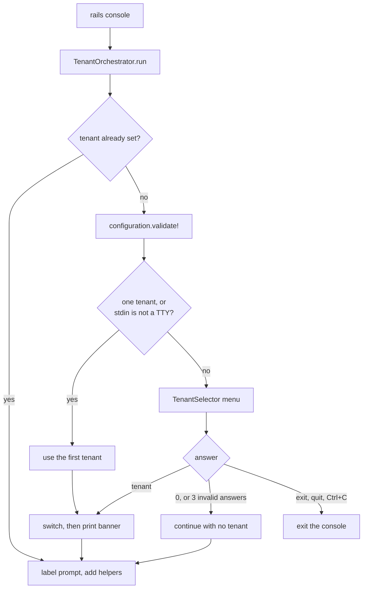

# Console Boot and Tenant Selection

What happens between typing `bin/rails console` and getting a `[tenant]` prompt, and what each
answer at the selection menu does.

Relevant source files

<ul>
<li><a href="https://github.com/Soumyadeep-ai/console_kit/blob/master/lib/console_kit/railtie.rb"><code>lib/<wbr>console_kit/<wbr>railtie.rb</code></a></li>
<li><a href="https://github.com/Soumyadeep-ai/console_kit/blob/master/lib/console_kit/tenant_orchestrator.rb"><code>lib/<wbr>console_kit/<wbr>tenant_orchestrator.rb</code></a></li>
<li><a href="https://github.com/Soumyadeep-ai/console_kit/blob/master/lib/console_kit/tenant_selector.rb"><code>lib/<wbr>console_kit/<wbr>tenant_selector.rb</code></a></li>
<li><a href="https://github.com/Soumyadeep-ai/console_kit/blob/master/lib/console_kit/setup_ui.rb"><code>lib/<wbr>console_kit/<wbr>setup_ui.rb</code></a></li>
<li><a href="https://github.com/Soumyadeep-ai/console_kit/blob/master/lib/generators/console_kit/install_generator.rb"><code>lib/<wbr>generators/<wbr>console_kit/<wbr>install_generator.rb</code></a></li>
<li><a href="https://github.com/Soumyadeep-ai/console_kit/blob/master/lib/generators/console_kit/templates/console_kit.rb"><code>lib/<wbr>generators/<wbr>console_kit/<wbr>templates/<wbr>console_kit.rb</code></a></li>
</ul>

## Install generator

`rails generate console_kit:install` copies `config/initializers/console_kit.rb` from the gem's
template and reminds you to set `tenants` and `context_class`. If the file already exists, Rails asks
before overwriting it. `--force` overwrites and `--skip` keeps yours.

The template wraps `ConsoleKit.configure` in `Rails.application.config.after_initialize`, and warns at
boot while `tenants` or `context_class` is still `nil`. See [Configuration](configuration.md) for
the settings.

## Boot sequence

The Railtie hooks into `rails console` only. Servers, jobs and `rails runner` never run it.

1. **`TenantOrchestrator.run`** does nothing if a tenant is already set. Otherwise it validates the
   whole configuration first, so a typo stops here rather than half-way through a switch.
2. **Auto-select.** With exactly one tenant, or when stdin is not a TTY (piped input, CI, a
   `rails console` started by a script), the first tenant is used without asking.
3. **Menu.** Otherwise `TenantSelector` lists `0. Skip` and every tenant with its partner code, then
   asks `Selection (number or name) [1]`.
4. **Switch.** The chosen tenant goes through `TenantConfigurator`, which runs the transactional
   switch and prints any failure instead of raising, so a bad tenant does not kill the session.
5. **Banner** on success: `Tenant initialized: <key>`, the environment warning (red for
   `production`, yellow for `staging`), `Active connections: ...`, and the dashboard when
   `show_dashboard` is on.
6. **Prompt and helpers.** The IRB or Pry prompt is labelled `[<key>]` (or `[no-tenant]`). The
   console helpers are added: through `IRB::ExtendCommandBundle` on IRB, or onto the top-level object
   on Pry.

Any unexpected error during boot is printed with its backtrace, and the console still starts.

## Answers at the menu

| Input | Result |
|---|---|
| Enter (empty) | The default, `1`: the first tenant |
| A number `1`…`n` | That tenant |
| A tenant name | That tenant. Matching ignores case. |
| `0` | No tenant. The console loads without tenant configuration. |
| `exit` or `quit` (any case) | At boot: exits the console |
| Ctrl+C, or end of input | At boot: exits the console |
| Anything else | A warning and the menu again, up to 3 attempts. After that the console loads without a tenant. |

## Switching later: `switch_tenant`

The `switch_tenant` console helper (and `ConsoleKit.reset_current_tenant`) shows the same menu, but
the answers mean slightly different things, because you are already inside a session:

| Input | Result |
|---|---|
| The current tenant | `Already using tenant: <key>`. Nothing changes. |
| Another tenant | A transactional switch, then the banner |
| `0`, `exit` or `quit` | Clears the tenant: the context is cleared and every backend is reset to its default |
| Ctrl+C or invalid input | `Tenant switch cancelled.` You stay on the current tenant. |

## Code reload

The Railtie also registers a `to_prepare` hook. Inside a console, `reload!` re-applies the current
tenant silently, so reloaded classes point at the same backends again. A failure prints
`Failed to reapply tenant '<key>'` and leaves the session running.
